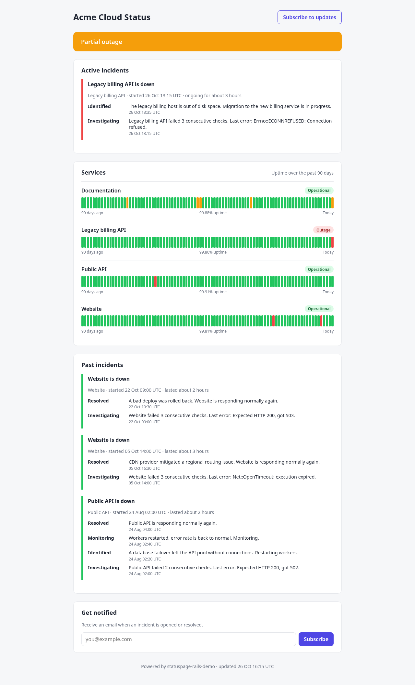

# statuspage-rails-demo

A small, self-hostable **status page + uptime monitor** built with Rails 8, PostgreSQL, Hotwire and plain CSS.
Portfolio demo — not a production service.



## Features

- **Monitors** (`UptimeMonitor`) — URL, expected HTTP status, check interval, failure threshold.
- **Background HTTP checks** — `ScheduleChecksJob` (Solid Queue recurring task, every 30 s) enqueues
  `CheckMonitorJob` for every monitor that is due; each check stores a `CheckResult` (status, HTTP code, latency, error).
- **Incidents** — auto-opened after *N* consecutive failures, auto-resolved on the first successful check,
  with a timeline of `IncidentUpdate`s. At most one open incident per monitor (partial unique index).
- **Public status page** (`/`) — overall status banner, per-monitor status, 90-day uptime bars (daily, UTC),
  active and past incidents. Auto-refreshes via Turbo morphing + a tiny Stimulus controller.
- **Email subscriptions** — double opt-in with a confirmation token, unsubscribe link, rate-limited signup;
  confirmed subscribers get a mail when an incident opens or resolves.
  Mail is delivered **only** to `letter_opener_web` (browsable at `/admin/mail`) or the test mailer — nothing is sent externally.
- **Admin** (`/admin`) — monitor CRUD + "Check now", behind HTTP Basic auth configured by env vars.
  If `ADMIN_PASSWORD` is not set, admin fails closed (503).

## Stack / architecture

| Concern | Choice |
|---|---|
| Framework | Rails 8.1, Ruby 3.3 |
| DB | PostgreSQL (single database; Solid Queue tables live in it) |
| Jobs | Solid Queue (`SOLID_QUEUE_IN_PUMA=1` runs the worker + scheduler inside Puma) |
| Frontend | Hotwire (Turbo Frames/Streams/morph, Stimulus), importmap, plain CSS (Propshaft) |
| HTTP probe | `Net::HTTP`, 10 s timeouts (`app/models/http_probe.rb`) |
| Tests | Minitest + WebMock (no real network) |

Key code: `app/models/concerns/checkable.rb` (threshold / incident state machine),
`app/models/status_page.rb` (overall status + 90-day bars), `app/jobs/*`, `config/recurring.yml`.

## Run locally

Tested on Debian trixie with the **system Ruby** (`/usr/bin/ruby`, 3.3.8, apt `ruby-full`) and
its bundled Bundler 2.5.22, which Debian installs as `bundle3.3`. No version manager and no
`GEM_HOME` are needed. Gems are installed into the project at `./vendor/bundle`, and the
setting is stored in `.bundle/config`.

Prerequisites (Debian/Ubuntu): `ruby-full build-essential libpq-dev libyaml-dev postgresql`.
PostgreSQL must be running and your OS user needs a Postgres role that can create
databases. For example:
`sudo service postgresql start && sudo -u postgres createuser -s "$USER"`.

```bash
cd statuspage-rails-demo
bundle3.3 config set --local path vendor/bundle   # once; use `bundle` instead if that is your Bundler binary
bundle3.3 install
bin/rails db:prepare          # create + migrate dev and test databases
bin/rails db:seed             # 4 demo monitors, 90 days of checks, incidents, 1 subscriber (idempotent)

export ADMIN_PASSWORD='choose-something'   # ADMIN_USERNAME defaults to "admin"
SOLID_QUEUE_IN_PUMA=1 bin/rails server     # runs web + background checks
```

- Status page: http://localhost:3000/
- Admin: http://localhost:3000/admin (basic auth)
- Captured mail: http://localhost:3000/admin/mail

You can override the DB connection with `DATABASE_HOST`, `DATABASE_USERNAME`,
`DATABASE_PASSWORD` and `DATABASE_NAME`. The seeded "Legacy billing API" points at
`http://127.0.0.1:9/health`, so it stays down and keeps its incident open.

## Tests & checks

Verified from a clean environment, with no `GEM_HOME` and no version manager:

```bash
env -i HOME="$HOME" PATH=/usr/bin:/bin bash -lc '
  cd statuspage-rails-demo &&
  bundle3.3 config set --local path vendor/bundle &&
  bundle3.3 install --quiet &&
  bin/rails db:prepare &&
  bin/rails test'
# => 47 runs, 174 assertions, 0 failures, 0 errors, 0 skips
```

Individual commands:

```bash
bin/rails test
bin/rubocop
bin/brakeman --no-pager -q
bin/bundler-audit
bin/importmap audit
```

## Docker (experimental)

`Dockerfile`, `bin/docker-entrypoint` and `docker-compose.yml` are included:

```bash
cp .env.example .env   # set ADMIN_PASSWORD
docker compose up --build
```

Status: the image builds, but in the author's sandbox `docker compose up` was **not verified** — the web
container stayed stuck in `db:prepare`. Use the local run above. A GitHub Actions workflow
(`.github/workflows/ci.yml`: brakeman, bundler-audit, importmap audit, rubocop, tests on Postgres) is
included but has not been run on GitHub.

## Design decisions

- `UptimeMonitor` instead of `Monitor` to avoid clashing with Ruby's `::Monitor`.
- One database: Solid Queue tables are a regular migration, which keeps setup trivial.
- Incident logic lives in the model (`record_check!`) so it's unit-testable without HTTP; the job only probes.
- Subscription endpoint returns the same response whether or not the email already exists (no enumeration).
- Credentials compared with `ActiveSupport::SecurityUtils.secure_compare`; no secrets in the repo.

## Limitations

- **SSRF:** admins can point monitors at any URL, including internal addresses. Fine for a trusted-admin demo, not for multi-tenant use.
- Mail goes only to letter_opener / test deliveries; no real SMTP.
- Single-region checks from one host; no retries/jitter, no latency SLOs.
- Uptime bars bucket by UTC day; "uptime" = share of successful checks, not time-weighted.
- Docker setup not verified end-to-end; `SECRET_KEY_BASE` is generated ephemerally if unset.

## Screenshots

`docs/screenshots/`: `status-page.png`, `status-page-mobile.png`, `admin-monitors.png`, `admin-monitor-detail.png`.
